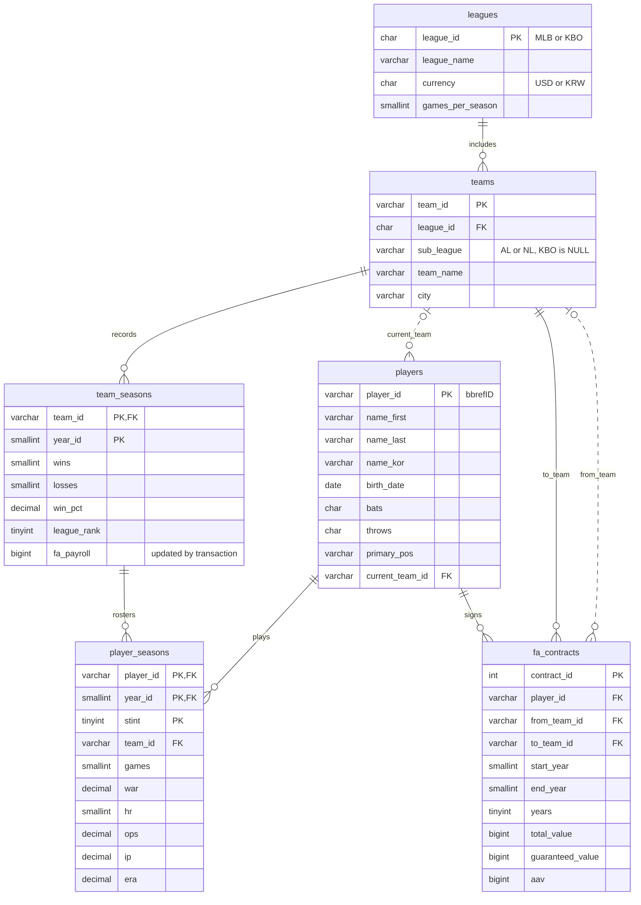

빅데이터응용 팀 프로젝트 · Data model v1

# FA Contract ValueFA 계약 효율성 분석 시스템 ERD

DBMS **MariaDB (XAMPP)** 테이블 **6개** 초기 데이터 **약 2,400건** 범위 **MLB 메인 + KBO 비교군**

## ER 다이어그램

PK 기본키 FK 외래키 IDX 보조 인덱스 실선 = 필수 관계 · 점선 = 선택(NULL 허용) 관계

분석의 축은 `fa_contracts`입니다. 계약 한 건이 `start_year`\~`end_year` 범위로 `player_seasons`(그 기간의 WAR)와 `team_seasons`(영입팀의 순위)에 연결됩니다. 이 기간 조인은 FK가 아니라 쿼리에서 거는 조건이라 다이어그램에는 선으로 나타나지 않습니다.

## 테이블 명세dbcreate.sql 기준

### leagues

마스터 · 리그 차원

2건

| 컬럼 | 타입 | 키 | 비고 |
| --- | --- | --- | --- |
| league_id | CHAR(3) | PK | 'MLB', 'KBO' |
| league_name | VARCHAR(50) |  |  |
| country | VARCHAR(30) |  |  |
| currency | CHAR(3) |  | USD는 달러, KRW는 만원 단위로 저장 |
| games_per_season | SMALLINT |  | 162 / 144, 경기당 지표 보정용 |

### teams

마스터 · 구단 차원

40건

| 컬럼 | 타입 | 키 | 비고 |
| --- | --- | --- | --- |
| team_id | VARCHAR(5) | PK | MLB는 Lahman teamID(NYA 등), KBO는 K_LG 형식 |
| league_id | CHAR(3) | FKIDX | → leagues |
| sub_league | CHAR(2) |  | AL / NL, KBO는 NULL |
| team_name | VARCHAR(50) |  |  |
| city | VARCHAR(30) |  |  |

### players

마스터 · 선수 차원

\~450건

| 컬럼 | 타입 | 키 | 비고 |
| --- | --- | --- | --- |
| player_id | VARCHAR(12) | PK | MLB는 bbrefID(WAR 파일과 조인 키), KBO는 k\_ 접두 코드 |
| name_first | VARCHAR(40) |  |  |
| name_last | VARCHAR(40) | IDX | 선수 검색용 |
| name_kor | VARCHAR(20) |  | KBO 선수 / 한국인 MLB 선수 |
| birth_date | DATE |  | 계약 시 나이 계산 |
| birth_country | VARCHAR(30) |  |  |
| bats / throws | CHAR(1) |  | R / L / B |
| primary_pos | VARCHAR(3) |  | SP, RP, C, SS ... |
| current_team_id | VARCHAR(5) | FK | → teams, NULL 허용 (트랜잭션에서 갱신) |

### team_seasons

팩트 · 구단 시즌 성적

\~380건

| 컬럼 | 타입 | 키 | 비고 |
| --- | --- | --- | --- |
| team_id | VARCHAR(5) | PKFK | → teams |
| year_id | SMALLINT | PKIDX | 복합 PK (team_id, year_id) |
| wins / losses | SMALLINT |  |  |
| win_pct | DECIMAL(4,3) |  |  |
| league_rank | TINYINT |  | 리그(MLB는 지구 아닌 AL/NL) 내 순위 |
| postseason | VARCHAR(10) |  | NONE / WC / DS / CS / WS / KS ... |
| runs_scored / runs_allowed | SMALLINT |  |  |
| fa_payroll | BIGINT |  | 그 시즌 유효한 FA 계약 AAV 합계 |

### player_seasons

팩트 · 선수 시즌 성적 + WAR

\~1,300건

| 컬럼 | 타입 | 키 | 비고 |
| --- | --- | --- | --- |
| player_id | VARCHAR(12) | PKFK | → players |
| year_id | SMALLINT | PKIDX |  |
| stint | TINYINT | PK | 시즌 중 이적 시 1, 2 … |
| team_id | VARCHAR(5) | FKIDX | (team_id, year_id) → team_seasons 복합 FK |
| games | SMALLINT |  |  |
| war | DECIMAL(4,1) |  | 타격+투구 합산 WAR |
| pa, hr, rbi, sb | SMALLINT |  | 타자 기록, 투수는 NULL |
| avg, ops | DECIMAL(4,3) |  |  |
| ip | DECIMAL(5,1) |  | 투수 기록, 타자는 NULL |
| p_wins, p_so | SMALLINT |  |  |
| era | DECIMAL(5,2) |  |  |

타자·투수를 한 테이블에 두고 해당 없는 칸을 NULL로 둡니다. 투타겸업 선수도 한 행으로 처리되고, 계약 기간 WAR 합계가 조인 한 번으로 나옵니다.

### fa_contracts

팩트 · FA 계약

\~250건

| 컬럼 | 타입 | 키 | 비고 |
| --- | --- | --- | --- |
| contract_id | INT AUTO_INCREMENT | PK |  |
| player_id | VARCHAR(12) | FK | → players |
| from_team_id | VARCHAR(5) | FK | → teams, 원소속팀 (NULL 허용) |
| to_team_id | VARCHAR(5) | FKIDX | → teams, 복합 IDX (to_team_id, start_year) |
| start_year | SMALLINT | IDX | 계약 첫 시즌 |
| end_year | SMALLINT |  |  |
| years | TINYINT |  |  |
| total_value | BIGINT |  | 총액 (옵션 포함) |
| guaranteed_value | BIGINT |  | 보장액, KBO 옵션 분리용 (MLB는 총액과 같음) |
| aav | BIGINT |  | 연평균 금액 = total_value / years |
| signed_date | DATE |  |  |

재계약 여부는 `from_team_id = to_team_id`로 판단하므로 별도 컬럼을 두지 않습니다.

합계: 2 + 40 + 약 450 + 약 380 + 약 1,300 + 약 250 = **약 2,400건**. MLB는 계약 첫 시즌 2016\~2024년, 성적은 계약 전 2년을 포함해 2014\~2025년을 기준으로 잡은 추정치입니다.

## 관계 정리

| 관계 | 카디널리티 | 설명 |
| --- | --- | --- |
| leagues → teams | 1 : N | 리그 하나에 여러 구단 |
| teams → team_seasons | 1 : N | 구단의 연도별 성적 |
| team_seasons → player_seasons | 1 : N | 복합 FK (team_id, year_id). 롤업 후 드릴다운 경로 |
| players → player_seasons | 1 : N | 선수의 연도별 성적, 윈도우 함수의 파티션 단위 |
| players → fa_contracts | 1 : N | 한 선수가 여러 번 FA 계약 가능 |
| teams → fa_contracts (to) | 1 : N | 영입 구단, 필수 |
| teams → fa_contracts (from) | 0..1 : N | 원소속 구단, 해외 복귀 등은 NULL |
| teams → players (current) | 0..1 : N | 현재 소속, 무소속·은퇴는 NULL |

## 요구사항과 테이블 매핑

| 요구사항 | 사용 테이블 | 구현 내용 |
| --- | --- | --- |
| 복합 그룹화 집계 | fa_contracts, players, player_seasons, teams | 리그 × 포지션 × 계약기간 구간별 AVG/MAX/MIN(AAV), SUM(WAR), WAR당 금액 |
| 롤업 / 드릴다운 | teams, team_seasons, fa_contracts | 리그 → 구단 → 연도 `WITH ROLLUP`으로 FA 지출·승수 소계, 구단 클릭 시 계약별·시즌별로 내려감 |
| 순위 | fa_contracts, player_seasons | `RANK() OVER (PARTITION BY league_id, start_year …)` 효율 순위, `NTILE(4)` 금액 4분위별 good/bad 비율 |
| 윈도우 함수 | player_seasons, team_seasons | 계약 기간 누적 WAR, `LAG(league_rank)`로 FA 영입 전후 순위 변화, 이동평균 WAR |
| INSERT / UPDATE / DELETE | fa_contracts, players | 계약 등록·수정·삭제, 선수 정보 수정 |
| 트랜잭션 | fa_contracts, players, team_seasons | FA 계약 등록 시 ① 계약 INSERT ② 선수 current_team_id UPDATE ③ 영입팀 해당 시즌 fa_payroll UPDATE, 실패하면 ROLLBACK |
| 세션 | players (조회만) | `$_SESSION['watchlist']`에 관심 선수 ID 저장, 비교 페이지에서 불러옴 |

## 설계 메모

#### 금액 단위

USD는 달러, KRW는 만원 단위로 저장합니다. 리그 간 금액을 직접 비교하지 않고, 효율과 순위는 항상 같은 리그 안에서 계산합니다.

#### 삭제 규칙

players 삭제 시 player_seasons와 fa_contracts는 ON DELETE CASCADE, teams 쪽 FK는 RESTRICT로 둬서 실수로 구단이 지워지지 않게 합니다.

#### 삽입 순서

dbinsert.sql은 leagues → teams → players → team_seasons → player_seasons → fa_contracts 순서여야 FK 오류가 나지 않습니다. dbdrop.sql은 그 역순입니다.

#### fa_payroll

계약 테이블에서 계산할 수 있는 값을 일부러 저장해 둔 캐시 컬럼입니다. 트랜잭션에서 함께 갱신할 대상이 생기고, 롤업 쿼리도 가벼워집니다.